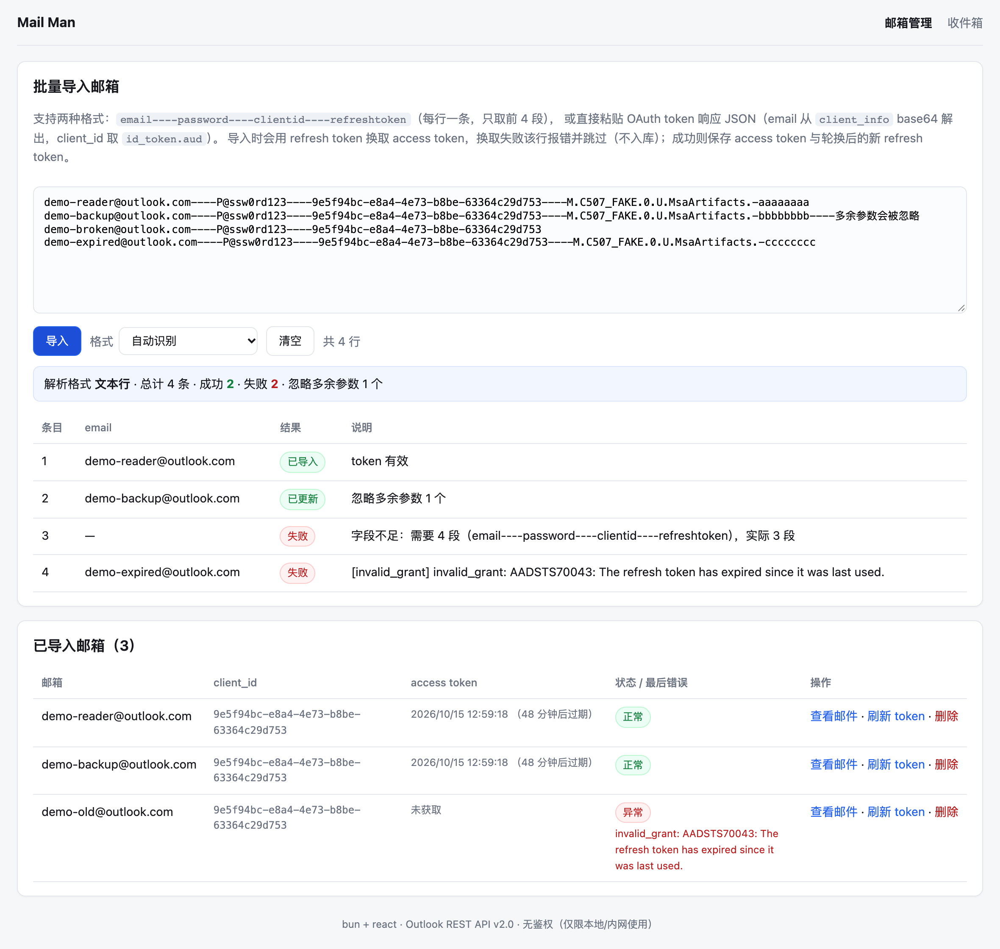
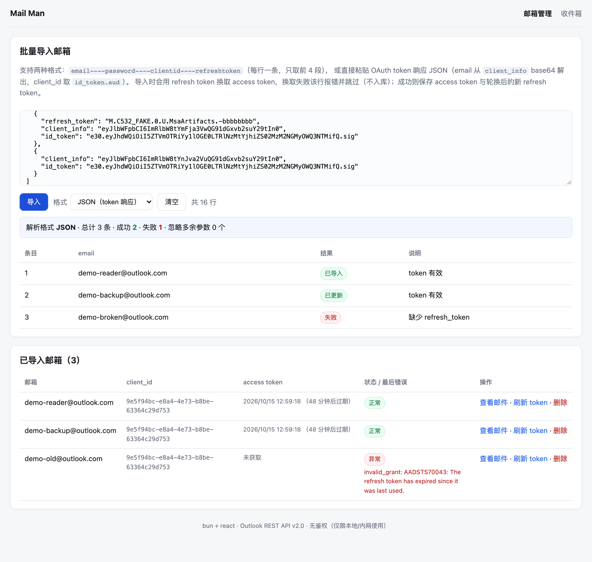
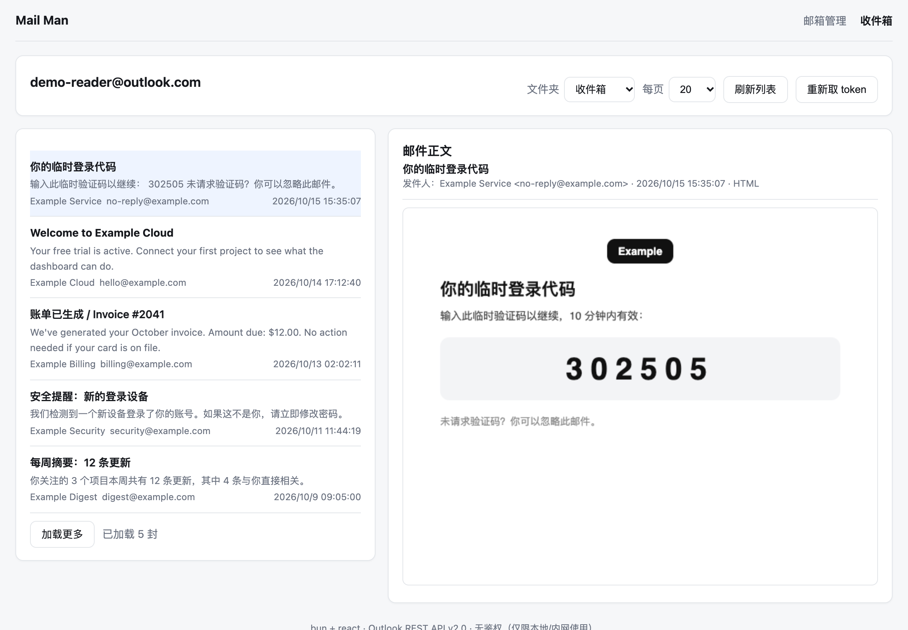
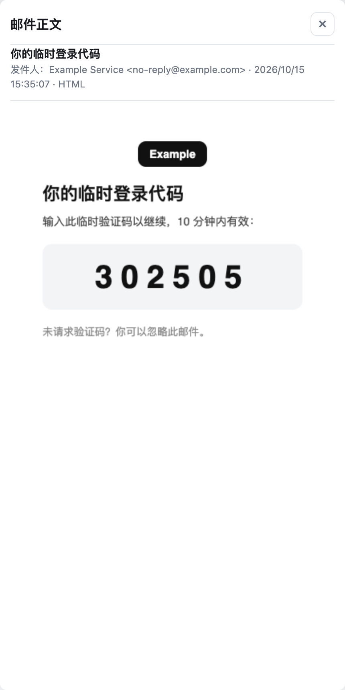

# mail-man

邮箱取件网站（v1，仅支持 Outlook / Microsoft 个人邮箱）。bun 单进程同时提供 API 与 React 前端，无鉴权。

## 快速开始

```bash
bun install
bun run dev          # http://localhost:3000  （PORT=3000 默认，--watch 热重启）
```

- 管理页：<http://localhost:3000/admin>
- 收件箱：<http://localhost:3000/inbox?email=xxx@outlook.com>

生产模式：`bun run start`（关闭前端 mtime 热更新、产物 minify）。

## 界面

<table>
  <tr>
    <td width="50%">管理页 <code>/admin</code>：文本行批量导入、逐行结果、邮箱列表<br></td>
    <td width="50%">管理页：JSON 导入（直接粘 OAuth token 响应）<br></td>
  </tr>
  <tr>
    <td width="50%">收件箱 <code>/inbox?email=xxx</code>（宽屏：左列表 / 右正文）<br></td>
    <td width="50%">收件箱窄屏（≤900px）：正文改为全屏弹窗，<code>Esc</code> 或 <code>×</code> 关闭<br></td>
  </tr>
</table>

> 截图中的邮箱地址、邮件内容与 token 均为演示数据。

## 导入格式

管理页可选解析格式（默认**自动识别**：内容以 `{` / `[` 开头走 JSON，否则走文本行）。

### 格式 A：文本行

每行一条，`----` 分隔，**只取前 4 段，多余参数忽略**；空行与 `#` 开头的行跳过：

```
email----password----clientid----refreshtoken
```

### 格式 B：JSON（直接粘 OAuth token 响应）

支持**单个对象**、**对象数组**、**每行一个 JSON**（JSON Lines）：

```jsonc
{
  "refresh_token": "M.C532_BAY.0.U.MsaArtifacts.-xxxx",
  "client_info": "<base64url>",   // 解出 email / preferred_username
  "id_token":    "<JWT>"          // aud 作为 client_id
}
```

字段来源优先级：

| 字段 | 取值顺序 |
| --- | --- |
| email | 显式 `email` → `client_info.email` → `client_info.preferred_username` → `id_token.email` → `id_token.preferred_username` |
| client_id | 显式 `client_id` → `id_token.aud`（`client_info` 里没有 client_id） |
| refresh_token | `refresh_token`（必需） |
| password | 显式 `password` / `account`（可选，仅保存不使用） |

解不出 email 或 client_id 时，该条目直接报错并说明原因（不静默兜底）；JSON 语法错误也作为条目错误返回，不抛 500。

导入流程（`POST /api/mailboxes/import`，默认并发 4）：

1. 解析并校验字段（email 格式、clientid / refreshtoken 非空），字段不足直接报错；
2. 用 `refresh_token` 调 `https://login.microsoftonline.com/common/oauth2/v2.0/token`
   （`scope=https://outlook.office.com/mail.read offline_access`）；
3. **换取失败 → 该行报错并跳过，不入库**（已存在的邮箱会被标记为异常并记录错误原因）；
4. **换取成功 → 保存 access token（含过期时间）+ 微软轮换后的新 refresh token**；
5. 结果逐行返回：`created` / `updated` / `error`（带微软 `error` 码与 `error_description`）。

> 注意：微软会轮换 refresh token，导入后数据库里的 refresh token 已是新值，原始那份可能失效。

## 页面

| 路由 | 说明 |
| --- | --- |
| `/` | 首页，已导入邮箱列表 |
| `/admin` | 批量导入、导入结果明细、邮箱列表（刷新 token / 查看邮件 / 删除） |
| `/inbox?email=xxx` | 邮件列表（文件夹、每页 10~100、加载更多），点击行看正文（沙箱 iframe，禁脚本）；缺 `email` 参数时给出可选列表 |

## API

| 方法 | 路径 | 说明 |
| --- | --- | --- |
| GET | `/api/health` | 存活 + 邮箱数 |
| GET | `/api/mailboxes` | 邮箱列表（不返回 token 明文） |
| POST | `/api/mailboxes/import` | body `{ text, format?: "auto"\|"lines"\|"json", concurrency? }`，响应含实际 `format` |
| POST | `/api/mailboxes/refresh?email=` | 强制刷新 access token |
| DELETE | `/api/mailboxes?email=` | 删除邮箱 |
| GET | `/api/messages?email=&folder=Inbox&top=20&skip=0` | 邮件列表 |
| GET | `/api/message?email=&id=` | 单封邮件正文 |

access token 提前 5 分钟视为过期自动刷新；同一邮箱并发请求只刷新一次（避免 refresh token 轮换互相打废）。
所有上游错误（`invalid_grant` / `AADSTSxxxx` / 401 等）原样返回给前端，不做静默兜底。

## 调试单个 token

```bash
bun run probe <client_id> <refresh_token> [message_id]
```

不走数据库，直接验证刷新、列表、正文三个接口。

## 目录结构

```
server.ts                 Bun.serve：路由 + 前端内存构建（源码 mtime 失效）
src/db.ts                 bun:sqlite（data/mailman.sqlite）邮箱与 token 存取
src/parse.ts              导入文本解析（纯函数，可单测）
src/import.ts             批量导入：并发刷新 token + 逐行结果
src/outlook.ts            token 端点 + Outlook REST v2.0，响应归一化
src/mail-service.ts       access token 缓存/自动刷新/并发去重
src/api.ts                HTTP 接口层
src/client/               React 前端（App / Admin / Inbox / api / css）
scripts/probe-outlook.ts  命令行探针
```

## 命令

```bash
bun run dev        # 开发（--watch）
bun run start      # 生产
bun test           # 15 个单测（解析 + outlook 报文/URL/错误）
bun run typecheck  # tsc --noEmit
```

## 已知限制

- **无鉴权**：任何人能看所有邮箱的邮件，仅限本地/内网使用。
- 密码字段只是随导入保存，未使用（不做 IMAP/SMTP 登录）。
- 仅 Outlook；Gmail 等需要各自的 provider 适配层。
- 基于 Outlook REST API v2.0（微软已宣布退役，后续应迁到 Microsoft Graph `/me/messages`，接口层已集中在 `src/outlook.ts`，替换成本低）。
- token 明文存于 `data/mailman.sqlite`（已在 `.gitignore` 中）。
- JSON 导入的 token 常见 `scope` 是 `service::outlook.office.com::MBI_SSL`，刷新时我们固定请求 `https://outlook.office.com/mail.read offline_access`；若上游拒绝该 scope 切换，错误会原样返回（`invalid_grant` / `AADSTSxxxx`），需要改用对应 scope 或重新取 token。
